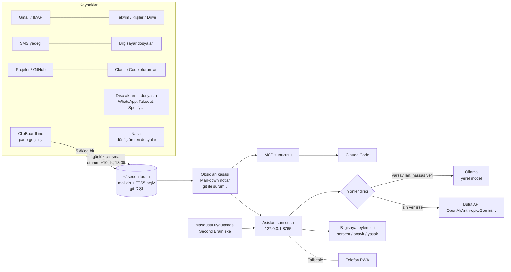

# Second Brain

**Kendi bilgisayarında çalışan, seni tanıyan bir ikinci beyin ve kişisel asistan.**
Mailin, takvimin, Drive'ın, rehberin, SMS'lerin, okul sistemin, kod projelerin, panoya kopyaladıkların, dönüştürdüğün dosyalar ve
yapay zeka sohbet geçmişin tek bir **Obsidian kasasında** toplanır, birbirine bağlanır ve her gün kendiliğinden güncellenir.
Üstünde iki asistan çalışır: bilgisayarındaki **yerel model** (ücretsiz, veri dışarı çıkmaz) ve **Claude Code** (seni ve işlerini
her oturumda hatırlar).

| | |
|---|---|
| Sürüm | **0.15.1** (bkz. [CHANGELOG.md](CHANGELOG.md)) |
| Platform | Windows 10/11 (birincil, günlük kullanımda) · macOS 13+ Apple Silicon (CI'da kurulup test edilir) · Linux: denenmedi |
| Özellik | 52 modül, 258 tek tek seçilebilen madde, 43 veri kaynağı, 18 hazır MCP, 2 gömülü uygulama |
| Belge | 136 sayfalık Türkçe kullanıcı rehberi: [system/docs/rehber/README.md](system/docs/rehber/README.md) |
| Test | 1.200+ otomatik test; her push'ta Windows'ta, her sürümde Windows ve macOS'ta sıfırdan kurulum + test |
| Erişim | Depo gizlidir; yalnız davet edilen kişiler kurabilir |

> **Bu README'yi okuyan biri** projenin ne yaptığını, nasıl kurulduğunu, verinin nereye gittiğini, neyin çalışıp neyin
> çalışmadığını ve sorun çıkınca ne yapacağını bilmelidir. Eksik ya da yanlış bir şey görürsen bu bir hatadır.

---

## İçindekiler
1. [Ne işe yarar](#1-ne-işe-yarar)
2. [Nasıl çalışır (mimari)](#2-nasıl-çalışır-mimari)
3. [Gömülü uygulamalar: ClipBoardLine ve Nashi](#3-gömülü-uygulamalar-clipboardline-ve-nashi)
4. [Gereksinimler ve donanım](#4-gereksinimler-ve-donanım)
5. [Kurulum](#5-kurulum)
6. [Kurulum sihirbazı adım adım](#6-kurulum-sihirbazı-adım-adım)
7. [Günlük kullanım](#7-günlük-kullanım)
8. [Veri kaynakları ve güncellik](#8-veri-kaynakları-ve-güncellik)
9. [Modeller ve yapay zeka sağlayıcıları](#9-modeller-ve-yapay-zeka-sağlayıcıları)
10. [Telefon](#10-telefon)
11. [Güvenlik ve gizlilik](#11-güvenlik-ve-gizlilik)
12. [Güncelleme, yedek ve geri alma](#12-güncelleme-yedek-ve-geri-alma)
13. [Sorun çıkınca](#13-sorun-çıkınca)
14. [Repo düzeni](#14-repo-düzeni)
15. [Geliştirme ve test](#15-geliştirme-ve-test)
16. [Bilinen sınırlar ve yol haritası](#16-bilinen-sınırlar-ve-yol-haritası)
17. [Lisanslar](#17-lisanslar)

---

## 1. Ne işe yarar

| Alan | Ne olur |
|---|---|
| **Toplama** | Gmail ve IMAP (Outlook, iCloud, Yandex, okul/şirket; **salt okunur**), Google Takvim, Kişiler, Drive, SMS/arama yedeği, bilgisayardaki dosyalar ve belge içerikleri, kod projeleri + GitHub, Claude Code oturumları, ders dosyaları, Telegram botu: **her gün kendiliğinden**. WhatsApp, Takeout, ChatGPT/Claude/Gemini geçmişi, Spotify, Notion, Evernote, Kindle, banka CSV ve 25+ kaynak: **dışa aktarma dosyasıyla** |
| **Kasa (Obsidian)** | Dersler, projeler, başvurular, kişiler, konular, kavramlar; hepsi `[[bağlantılı]]`, kümelere ayrılmış, renkli bilgi grafiği. Tekrar eden kişiler kurallarla birleştirilir |
| **Takvim** | Mail/SMS'ten tarih çıkarılır. Güveni düşük olan (ve yerel modelin bulduğu her tarih) önce onay listesine düşer. Etiket kuralları (`[SINAV]`, `[ÖDEV]`…) renk ve hatırlatma verir |
| **Sabah özeti** | Her gün: takvim, 7 günlük teslimler, önemli mailler, bekleyen onaylar, başarısız adımlar. Kasaya not olarak yazılır, istenirse mail/Telegram ile gelir |
| **Yerel asistan** | Kasana soru sor, takvime onaylı ekle, notu güncelle/arşivle (git ile geri alınır), kural ve hafıza öğret, uygulama aç, Spotify/YouTube, ekran/kamera okuma, onaylı WhatsApp, 15 dk kala bildirim. Masaüstü penceresinde ve telefonda |
| **Claude Code hafızası** | Her oturumun başında kuralların, hafızan, açık konular, son oturum kartları ve o klasörün projesi bağlama eklenir; oturum sonunda devir kartı yazılır. `second-brain` MCP sunucusu ve 6 skill |
| **Verimlilik / okul / kariyer** | Görev panosu, günlük plan, pomodoro, alışkanlık, haftalık gözden geçirme; ders panosu, GANO ve senaryo, çalışma planı; mail taslağı (yalnız kasada), takip, CRM, teklif, saat takibi, CV |
| **Pano ve dosyalar** | [ClipBoardLine](#3-gömülü-uygulamalar-clipboardline-ve-nashi) kopyaladığın her şeyi tutar, Second Brain aranabilir yapar. [Nashi](#3-gömülü-uygulamalar-clipboardline-ve-nashi) dosya dönüştürür, çıktıları beyne girer |

Tam liste: 258 madde, her biri için "ne işe yarar / nasıl açılır / ne ister": [17-ozellik-katalogu](system/docs/rehber/17-ozellik-katalogu.md).

## 2. Nasıl çalışır (mimari)



**Parçalar:**
- `sb` — Python paketi (CLI + kütüphane). Her şey `sb <komut>` ile çalışır (`sb --help`, 90+ komut; tam liste [14-komut-referansi](system/docs/rehber/14-komut-referansi.md)).
- **Kasa** — düz Markdown + YAML ön bilgi. Obsidian olmadan da okunur. Kasa kendi git deposudur; her asistan değişikliği bir commit'tir.
- **Yerel arşiv** `~/.secondbrain/` — mail/SMS/öğe veritabanı (SQLite + FTS5), kayıtlar, çökme raporları. Kasaya ve git'e girmez.
- **Asistan sunucusu** — yalnız `127.0.0.1` üzerinde; arayüz düz HTML/CSS/JS (derleme adımı yok), masaüstü penceresi pywebview.
- **Eklenti sistemi** — her modül, veri kaynağı, MCP ve uygulama `system/plugins/` altında bir YAML manifesti. Yeni sektör, kaynak ya da yazılım kod değişmeden manifestle eklenebilir.
- **Zamanlanmış işler** — Windows Görev Zamanlayıcı / macOS launchd: günlük çalışma (oturum açılınca +10 dk ve 13:00), haftalık (Pazar 15:00), asistan sunucusu (oturum açılınca).

Ayrıntı: [docs/MIMARI.md](docs/MIMARI.md) · tasarım kararları: [docs/NEDEN.md](docs/NEDEN.md).

## 3. Gömülü uygulamalar: ClipBoardLine ve Nashi

İki açık kaynak uygulama, **resmî sürümleriyle olduğu gibi** kurulur ve Second Brain ile birlikte çalışır. Kaynak kodlarının tam kopyası
`apps/` altındadır (hangi commit'ten alındığı her birinin `UPSTREAM.md` dosyasında).

| | ClipBoardLine | Nashi |
|---|---|---|
| Ne yapar | Kopyaladığın görsel, metin ve bağlantıları üç rafta tutar; sabitleme, klasör, etiket, OCR'lı arama, önizleme, işaretleme/kırpma | 27 araç, 46 giriş biçimi: görsel/PDF/belge/medya dönüştürme, kırpma, QR, link'ten medya indirme |
| Kaynak | [orkunisitmak/clipboardline](https://github.com/orkunisitmak/clipboardline) · `apps/clipboardline` | [orkunisitmak/nashi-app](https://github.com/orkunisitmak/nashi-app) · `apps/nashi` |
| Windows | Electron, `ClipBoardLine-Setup-<sürüm>-x64.exe` (~520 MB) | WPF/.NET, taşınabilir `Nashi-Windows-x64.zip` (~91 MB) |
| Kurulduğu yer | `%LOCALAPPDATA%\Programs\clipboardline-desktop\` | `%LOCALAPPDATA%\Programs\Nashi\` |
| Kendi verisi | `%APPDATA%\ClipBoardLine\library.json` + `media\` | `%LOCALAPPDATA%\Nashi\library.json` (son 50 çıktı) |
| Beyne ne girer | **Her şey**: metin, bağlantı, görsel OCR metni, ad, etiket, klasör. Şifre, API anahtarı, kart, IBAN, TCKN, OTP içeren kayıt **atlanır** ve sayısı raporlanır | Dışa aktarılan dosyanın adı, türü, zamanı; PDF/metin/belge/görsel içeriği okunabiliyorsa içerik |
| Ne sıklıkla | Asistan açıkken 5 dk'da bir + günlük çalışma | Aynı |

**Nasıl kurulur:** Sihirbazın "Uygulamalar" bölümünde ya da komutla:
```bash
sb apps list                      # katalog ve durum
sb apps install clipboardline     # resmî sürümü indirir, SHA-256'yı yayıncının SHA256SUMS'u ile karşılaştırır, kurar
sb apps install nashi
sb apps autostart clipboardline login    # login = bilgisayar açılınca · startup = "Çalışmaya başla" ile · off
sb apps start nashi
sb apps sync all                  # kütüphanelerini şimdi beyne al
sb apps update                    # yeni sürüm var mı: yalnız BİLDİRİR, kurmaz
sb apps update nashi --accept <sürüm>   # yeni sürümü kabul et: özeti sabitler ve kurar
```
- **Sürüm sabit:** kit her uygulamanın bilinen iyi sürümünü ve dosya SHA-256'sını içerir; kurulum yalnız o sürümü kurar ve indirileni bu sabit özetle (ek olarak yayıncının `SHA256SUMS`'u ile) karşılaştırır. Uyuşmazsa dosya silinir ve kurulum durur. Yeni sürüm otomatik gelmez; `sb apps update` haber verir, sen `--accept` ile onaylarsın. Bu, yayıncı hesabı ele geçirilse bile kötü bir sürümün sessizce kurulmasını önler.
- Şirket paketlerinde (`tekstil`) ClipBoardLine ve Nashi varsayılan kapalıdır.
- Nashi taşınabilir zip olduğu için kurulum Başlat menüsüne **Nashi** kısayolu ekler; ClipBoardLine kendi kurucusuyla zaten ekler.
- Second Brain bu uygulamaların dosyalarına **hiç yazmaz**; kütüphanelerini salt okunur kopyalayarak okur.
- **Başlangıç:** kurulumda her uygulama için sorulur, varsayılan "bilgisayar açılınca". Bu, Windows'ta `HKCU\…\Run` girdisidir ve `sb apps autostart <id> off` ile kaldırılır.
- **ClipBoardLine'ın kendi ayarı:** metin ve görsel toplama ClipBoardLine'da varsayılan **kapalıdır** (yalnız bağlantılar açık). Hepsinin beyne girmesi için ClipBoardLine → Settings → Sources'ta metin ve görsel toplamayı aç.
- **Nashi ilk açılış:** "Download media tools" (FFmpeg, yt-dlp, Deno, ~180 MB) video/ses için gerekir. "Office tools" (LibreOffice, ~360 MB) yalnız Office belgeleri için.
- macOS dalı yazılıdır ama gerçek Mac'te denenmedi.

Ayrıntı ve sorun giderme: [22-uygulamalar](system/docs/rehber/22-uygulamalar.md).

## 4. Gereksinimler ve donanım

| Gerekli | Not |
|---|---|
| Windows 10/11 ya da macOS 13+ | Linux: kurucu çalışır ama zamanlayıcı, paket ve CI yok |
| Internet + GitHub hesabı (depoya davetli) | Depo gizli |
| [Obsidian](https://obsidian.md) | Kasayı görmek için (veriler Obsidian'sız da durur) |
| Google hesabı + Google Cloud OAuth istemcisi | Gmail/Takvim/Drive için; 5 dk, ücretsiz ([docs/KURULUM-GOOGLE.md](docs/KURULUM-GOOGLE.md)) |
| uv + Python 3.12 | Kurucu kendisi kurar |
| [Ollama](https://ollama.com) | Yerel model için (önerilir; sihirbaz kurar) |
| [Claude Code](https://claude.com/code) | Önerilir: derin derleme, MCP, hafıza |
| Tailscale | İsteğe bağlı, telefon için |

**Donanım:** sihirbaz ekran kartı belleğine (VRAM) bakıp profil önerir.

| Profil | VRAM | Yazı modeli | Görüntü modeli | İndirme |
|---|---|---|---|---|
| Güçlü | ≥ 14 GB | qwen3:14b | qwen3-vl:8b | ~15,4 GB |
| Orta | 8–14 GB | qwen3:8b | qwen3-vl:4b | ~8,5 GB |
| Küçük | 4–8 GB | qwen3:4b | yok (yalnız OCR) | ~2,6 GB |
| Bulut | < 4 GB / GPU yok | qwen3:1.7b (yalnız özet) | yok | ~1,4 GB |

- **Windows önerisi:** 16 GB RAM, 8 GB VRAM NVIDIA, ~25 GB boş disk. Asgari: 8 GB RAM ve bulut profili.
- **Mac:** birleşik belleğin ~%70'i VRAM sayılır (8 GB → küçük, 16 GB → orta, 32 GB+ → güçlü). Intel Mac bulut profiline düşer.
- **Zayıf makinede:** "Zayıf laptop / bulut" hazır seçimi. Sohbet bulut API'ye gider, hassas içerik yine de dışarı çıkmaz.
- RAM/disk rakamları ölçüme değil deneyime dayanır; sihirbaz yetersiz RAM/disk için henüz uyarmıyor.

## 5. Kurulum

**Tek komut** (GitHub'a giriş yapılmış bir bilgisayarda; `<hesap>` depo sahibinin adı):
```powershell
# Windows PowerShell
irm https://raw.githubusercontent.com/<hesap>/second-brain-kit/main/install.ps1 | iex
```
```bash
# macOS
curl -fsSL https://raw.githubusercontent.com/<hesap>/second-brain-kit/main/install.sh | sh
```
Komut masaüstüne **Second Brain Setup** (Windows `.exe`, Mac `.app`) indirir ve açar. Ya da [Releases](../../releases)'tan
`Second-Brain-Setup.exe` / `Second-Brain-Setup-macOS.zip` indir.

- **Kurulum dosyası imzasız.** Windows SmartScreen "Windows bilgisayarınızı korudu" der: **Ek bilgi → Yine de çalıştır**. macOS "açılamıyor" der: sağ tık → Aç.
- Tek komutlu kurucu indirdiği Setup dosyasının SHA-256'sını sürümdeki `SHA256SUMS` ile **kendisi doğrular**; uyuşmazsa ya da özet yoksa dosyayı siler ve durur. Elle indirdiysen aynı karşılaştırmayı sürüm sayfasındaki `SHA256SUMS` ile yap. Kurulu kopyayı doğrulamak için: `sb verify` (kodu kitin `SHA256SUMS`'u ile karşılaştırır; değişmiş/eksik dosyaları listeler, `config`, `.venv` ve kullanıcı verisini atlar; çıkış 0 = uyuşuyor, 1 = fark var, 2 = özet dosyası yok). Kökteki `SHA256SUMS` git'in sakladığı LF içerikten üretilir, temiz bir checkout'ta tutar.
- **Komut satırı yolu** (sihirbazsız, repo klasöründe): `powershell -ExecutionPolicy Bypass -File install.ps1` ya da `bash install.sh`. Sessiz kurulum için `SB_SECRET_<ALAN>` ortam değişkenleri kullanılır.
- **`sb` komutu:** kurulum terminale `sb` komutunu ekler (Windows `%USERPROFILE%\.secondbrain\bin\sb.cmd`, kullanıcı PATH'ine; macOS `~/.local/bin/sb`). Kurulumdan sonra **yeni açılan** bir terminalde hangi klasörde olursan ol `sb doctor`, `sb apps status` yazman yeter. Bu README'deki tüm `sb …` komutları bu kısayolu varsayar.
- **Denemek için:** sihirbazı gerçek sisteme dokunmadan açmak istersen `SB_SETUP_SANDBOX=<klasör>` ile ya da `--sandbox` bayrağıyla başlat. Sağ üstte "DENEME KİPİ" yazar; anahtarlar dosyaya, komutlar "[deneme] atlandı" olur.

Ekran görüntülü tam anlatım: [01-kurulum](system/docs/rehber/01-kurulum.md).

## 6. Kurulum sihirbazı adım adım

| # | Adım | Ne sorulur / ne yapılır |
|---|---|---|
| 1 | Hoş geldin | Dil (TR/EN), deneme kipi bilgisi, yarım kalan kurulumu sürdürme |
| 2 | Hazır seçim | 4 eksen: **meslek** (öğrenci, ajans, yazılımcı, akademisyen, girişimci, satış, içerik, araştırmacı), **donanım** (güçlü GPU, orta, zayıf/bulut, Mac), **gizlilik** (tam yerel, karma, bulut), **yoğunluk** (minimal, günlük, güç) |
| 3 | Bütün özellikler | 258 maddenin hepsi tek tek açılıp kapatılabilir; kategori, arama, ne gerektirdiği rozeti |
| 4 | Kişisel bilgiler | Ad, kasa klasörü (OneDrive ve 260 karakter yol uyarısı), saat dilimi, okul/iş, rol |
| 5 | Hesaplar | Google (OAuth, istemci dosyası yükleme), IMAP/Gmail uygulama şifresi, Outlook, iCloud, Tailscale testi |
| 6 | API anahtarları | OpenAI, Anthropic, Gemini, OpenRouter, Groq, DeepSeek, Mistral…; işletim sistemi anahtarlığına yazılır, bağlantı testi |
| 7 | Yerel modeller | Donanım taraması, profil önerisi, Ollama kurulumu, model indirme ilerlemesi, ses (Whisper) |
| 8 | MCP | Claude Code/Desktop'a bağlama, 18 hazır MCP kataloğu, kendi MCP'ni ekleme |
| 9 | Veri yükleme | Seçimine göre gereken kaynaklar: "bu dosyayı nasıl alırsın" anlatımı, sürükle-bırak, önizle, içe aktar, geçmiş |
| 10 | Telefon | Tailscale durumu, asistan adresi, 6 haneli eşleme kodu |
| 11 | Başlangıç | Second Brain ve ClipBoardLine/Nashi bilgisayar açılınca mı, "Çalışmaya başla" ile mi |
| 12 | Özet ve kurulum | Seçimlerin özeti, kurulum ilerlemesi, sağlık testi, sonraki adımlar |

Kurulum bitince sihirbaz **ayarlar** kipinde (`?mode=settings`) masaüstü uygulamasının içinden yeniden açılır; her şeyi sonradan değiştirebilirsin.
Ayrıntı: [02-sihirbaz-adim-adim](system/docs/rehber/02-sihirbaz-adim-adim.md).

## 7. Günlük kullanım

**Masaüstü uygulaması** (`Second Brain.exe`): tek pencere, tepsi simgesi, isteğe bağlı bilgisayarla açılma. **Çalışmaya başla** düğmesi sırayla:
güncelleme denetimi → sağlık testi (`sb doctor`) → bugünün günlük işleri (yapılmadıysa) → uygulamalar ("Çalışmaya başla ile" seçilenler başlar + senkron) → modeli ısıtma → hazır.

| İstek | Nerede |
|---|---|
| "Bu hafta neler var?", "son mail neydi", "X projesinde ne karar verdik" | Asistan ya da Claude Code |
| "Cuma 15:00 doktor ekle", "takvimdeki X'i sil" | Asistan → onay kartı |
| "Başvurum kabul edildi", "şu notu arşivle", "geri al" | Asistan (kasa değişikliği, git commit) |
| "Not al: …" | Asistan → `00-Inbox/Dump` → her gün yerine dağıtılır |
| "Bundan sonra hep şöyle yap" / "Bunu hatırla" | `Asistan kuralları.md` / `Asistan hafızası.md` (Claude Code da okur) |
| Kopyaladığım bir şeyi bulmak | Asistanda ara (ClipBoardLine kayıtları dahil) ya da ClipBoardLine'da `Ctrl+Alt+T` |
| Dosya dönüştürmek | Nashi; çıktı otomatik beyne girer |
| Video, makale, aklına gelen şey | Kopyala → `Ctrl+Alt+B` (Beyne at) ya da telefonda Paylaş → İkinci Beyin |
| "Bugün ne var?" | Uygulama açılınca ilk ekran **Bugün**: 7 günlük teslim/sınav/etkinlik, bekleyen onaylar, önemli okunmamış mailler, eskiyen kaynaklar. Terminalde `sb today` (`--json`) |
| Dışa aktardığım dosyayı (WhatsApp zip, Takeout, Spotify…) içeri almak | Kasadaki `00-Inbox/İçe aktar/` klasörüne at. Türü tanınır ve içe aktarılır (10 dk'da bir ve günlük çalışmada); dosya `_işlendi/<tarih>/` altına taşınır, silinmez; aynı dosya ikinci kez alınmaz; tanınmazsa `_tanınmadı/` altına taşınır ve Onaylar'da kaynağını seçmen istenir |
| "Son günlerde ne yaptık?" | `sb recap` / asistan |
| "Bu kelimenin anlamı/yazımı?" | Asistan TDK sözlüğüne (sozluk.gov.tr) bakarak cevaplar; kendi bilgisiyle uydurmaz |
| Sabah özetim gelmedi ya da spam'e düştü | Her gönderimden sonra özetin Gmail'de gelen kutusuna mı spam'e mi düştüğü salt okunur kontrol edilir; spam'se masaüstü bildirimi ve sonraki özette uyarı çıkar |
| Bekleyen onaylar (komut, takvim, WhatsApp, tarih adayları, otomasyon) | Asistanın üst çubuğunda ✓ ve sayı → **Görünümler → Onaylar**. Tek liste; Obsidian'daki `00-Inbox/onay-bekleyenler.md` aynı listenin görünümü (`[x]` = onay, satırı silmek = iptal). Kartlar yeniden başlatmada kaybolmaz, süresi dolunca düşer |
| Uzun gece işi | `geceye ekle: iş @klasör` → `gece koşusunu başlat` (yalnız bilgisayardan, onaylı) |

Asistan kullanımı: [09-asistan-kullanimi](system/docs/rehber/09-asistan-kullanimi.md) · uygulama turu: [08-uygulama-turu](system/docs/rehber/08-uygulama-turu.md).

## 8. Veri kaynakları ve güncellik

Her kaynağın manifestinde bir **tazelik eşiği** vardır (`refresh:`: otomatik / dışa aktarma / elle, kaç günde bir, nasıl güncellenir ipucu). Sistem her kaynağın son başarılı içe aktarmasını kaydeder; eşik aşılınca kaynak **eskiyor**, iki katı aşılınca **bayat** olur. Uyarılar Bugün ekranında, üst çubuktaki rozette, sabah özetinde ve `sb doctor`'da görünür; `sb freshness` tam tabloyu verir. Hiç kullanmadığın kaynak bayat diye uyarmaz.

| Sıklık | Kaynaklar |
|---|---|
| **Sürekli / 5 dk** | Takvim hatırlatmaları, ClipBoardLine, Nashi, telefondan "Beyne at", Syncthing klasörü |
| **Günlük** (oturum +10 dk ve 13:00; kaçırılırsa açılınca) | Gmail, IMAP hesapları, Google Takvim, Drive, Kişiler, SMS/arama yedeği (sıklığını telefondaki yedek uygulaması belirler), bilgisayar dosyaları ve içerikleri, projeler/GitHub, Claude Code oturumları, ders dosyaları, Telegram botu |
| **Haftalık** (Pazar 15:00) | Özet, hijyen raporu, bağlantı ve küme önerileri |
| **Dışa aktarma dosyasıyla** (`sb import <kaynak> <dosya>` ya da sihirbaz 9. adım) | WhatsApp, Telegram Desktop, Discord, Slack, Instagram, X, LinkedIn, Takeout (Gemini, Chrome, Keep, YouTube, Fotoğraflar, Konum), Spotify (tam geçmiş ve teknik günlük paketi), Kindle, Notion, Evernote, OneNote, Apple Notlar, Pocket, Raindrop, Zotero, BibTeX, banka CSV, Coursera/Udemy, ekran süresi, Todoist/TickTick/Trello/Jira/Linear/MS To Do, ChatGPT/Claude/Gemini sohbetleri, tarayıcı geçmişi |
| **Elle** | ÖBS (`data/obs.yaml`), RSS/arXiv (`sb import rss`) |
| **Okul ders siteleri (Moodle/e-destek, UZEM)** | `sb moodle-login` + `sb moodle-sync` (resmî mobil servis, salt okunur, adres `lms.moodle_url` ayarında) ders notlarına haftalık içerik, duyuru ve teslimleri yazar, dosyaları indirir. ÜNİ UZEM için ayrıca `sb uzem sync` (ilk çalıştırma elle: önce `--dry-run`). Dosyalar kasada `40-Kaynaklar/UZEM/` altında durur ama git'e, telefona ve GitHub'a gitmez; yedeğe girer |

Dışa aktarılan kaynakları güncel tutmak senin elinde. Öneri: WhatsApp ve sohbet geçmişleri ayda bir, Takeout 2 ayda bir planlı, banka ay sonu.
Her kaynağın "nasıl alınır" anlatımı: [system/docs/rehber/kaynaklar/](system/docs/rehber/kaynaklar/).

## 9. Modeller ve yapay zeka sağlayıcıları

- **Yerel:** Ollama (varsayılan), LM Studio, llama.cpp, vLLM.
- **Bulut:** OpenAI, OpenRouter, Groq, DeepSeek, Mistral (OpenAI uyumlu; `base_url` ile Azure/vekil sunucu dahil), Anthropic, Gemini.
- `config/llm.yaml`: görev başına hedef (`tasks:`), kurallar (`routing:`), hata/kota olunca yedek zinciri (`fallback:`), yanıt önbelleği. Maliyet `sb usage`, yerel 0 USD.
- **Gizlilik süzgeci:** şifre, API anahtarı, OTP, kart, TCKN ve IBAN içeren metin ile `private` notlar buluta **hiç** gitmez, yerel modele düşer. "Tam yerel" + "sıkı" izin profilinde hiçbir istek buluta gitmez.
- Claude Code (`claude -p`) aboneliğinle derin derleme işlerinde kullanılır.
- **Bulut ↔ yerel anında geçiş:** `config/llm.yaml` → `tasks.chat: gemini:gemini-2.5-flash` (örnek) ile asistan sohbeti bulutta çalışır. Asistanın üst çubuğunda model etiketine tıklayarak (bilgisayarda ve telefonda) ya da `sb chat-mode local|cloud|status` ile **istediğin an yerele geçersin**. Her cevabın altında hangi modelin yazdığı görünür. Bulut hata verirse o tur yerelle cevaplanır ve sana söylenir (sessiz düşme yok).
- **Bulut modunun gizlilik bedeli:** o turun mesajı, sohbet geçmişi ve kasadan/mail/SMS'ten getirilen ilgili parçalar sağlayıcıya gider. Şifre, IBAN, kart, TC kimlik ve `private` notlar yerelde kalır. Gemini API'nin ücretsiz katmanında içerikler sağlayıcı tarafından ürün geliştirmede kullanılabilir (ücretli katmanda kullanılmaz; güncel şartları kontrol et).
- **Abonelik ≠ API:** Google AI Pro/Claude Pro gibi tüketici abonelikleri, yazılımların kullandığı API kotasını kapsamaz. Gemini komut satırı aracı bireysel hesaplar için kapatıldığından Gemini abonelik planıyla asistana bağlanılamaz.
- **Günlük harcama sınırı:** `config/llm.yaml` `budget` (varsayılan günlük 2, aylık 10 dolar); aşılırsa bulut çağrısı yapılmaz.

## 10. Telefon

Telefon kendi model çalıştırmaz; bilgisayardaki asistana **Tailscale** özel ağıyla bağlanır. Asistan bir **PWA**dır: ana ekrana eklenir.
Cihaz eşleme 6 haneli kodla yapılır.

| | Android | iOS |
|---|---|---|
| Asistan | ✔ | ✔ |
| Paylaş → İkinci Beyin | ✔ (paylaş hedefi) | Kestirmeler (Shortcuts) ile |
| Bildirim | Web Push (Tailscale HTTPS + `pywebpush`) | Yalnız ana ekrana eklenmiş PWA'da, iOS 16.4+ |
| SMS/arama yedeği | ✔ | ✘ |

- Bilgisayar kapalıysa telefon çalışmaz; çevrimdışı yalnız gönderme kuyruğu çalışır.
- Telefondan gelen her bilgisayar eylemi onaya düşer. Komut, WhatsApp, gece koşusu ve izin profili değişikliği telefondan onaylanamaz.

Ayrıntı: [docs/KURULUM-TELEFON.md](docs/KURULUM-TELEFON.md).

## 11. Güvenlik ve gizlilik

**İlke: veri senin bilgisayarında kalır, dışarı yalnız açık izinle çıkar.**

- **Mail salt okunur:** Gmail `readonly`, IMAP `EXAMINE`. Kod mail gönderemez ya da silemez; taslaklar yalnız kasaya yazılır. Tek istisna, kendi adresine giden sabah özeti.
- **Sırlar:** Windows Kimlik Yöneticisi / macOS Anahtar Zinciri. Dosyaya, repoya, kasaya ya da günlüklere yazılmaz.
- **Asistan eylemleri üç sınıf:** **serbest** (geri alınabilir), **onaylı** (kart), **yasak** (onayla bile çalışmaz).
  - Komutlar ayrıştırılıp sınıflanır; alt ifade, kodlanmış komut, zincirleme ve `python -c` gibi yollar onaya düşer.
  - Mail/SMS/belge/web/ekran içeriği okunduğu oturumda komut ve kalıcı yazma işlemleri **her zaman** onaya düşer (istem enjeksiyonuna karşı).
- **İzin profilleri** (`config/izinler.yaml`): sıkı / normal / serbest. Profiller yalnız onay ekler, hiçbiri takvim/WhatsApp/silme onayını kaldırmaz. Profil dosyası okunamazsa sıkıya düşer.
- **Ağ yüzeyi:**
  - Sunucular yalnız `127.0.0.1` dinler. Host/Origin denetimi yapılır, durum değiştiren isteklerde oturum jetonu aranır, port tek sürece bağlanır.
  - Dış URL çekme yalnız herkese açık adreslere gider (SSRF koruması).
- **Silme yok:** silinen not `90-Arşiv`e taşınır. Her asistan değişikliği git commit'idir ve geri alınabilir.
- **Gömülü uygulamalar:** yalnız yayıncının resmî GitHub sürümünden indirilir, SHA-256 doğrulanır. Kütüphaneleri salt okunur okunur, sır içeren pano kaydı beyne girmez.
- **Bilinen açık noktalar (dürüst):**
  - Kurulum dosyaları ve güncellemeler **kod imzalı değil**.
  - Kasa şifrelemesi git geçmişindeki eski düz metni kendiliğinden silmez. `sb encrypt` bunu kaç not ve hangi commit aralığı olarak söyler; temizlemek için ayrı ve onaylı komut var: `sb encrypt --purge-history <klasör> --confirm`. Bu komut önce şifreli tam yedek alır, uzak depoya zorla push gerektirir ve geri alınamaz.
  - KVKK paketi (aydınlatma metni, saklama/silme politikası) yok.
  - Çok kullanıcılı/rol bazlı yetki yok.

Ayrıntı: [docs/GUVENLIK.md](docs/GUVENLIK.md) · denetim özeti (30 bulgu + bağımsız inceleme, durumlarıyla): [docs/GUVENLIK-DENETIM-OZET.md](docs/GUVENLIK-DENETIM-OZET.md) · [10-guvenlik-gizlilik](system/docs/rehber/10-guvenlik-gizlilik.md).

## 12. Güncelleme, yedek ve geri alma

```bash
sb update            # ne geleceğini gösterir, onay ister, kod yedeği alır, günceller
sb update --check    # yalnız bak
sb update --rollback # son kod yedeğine dön
sb update --recover  # yarım kalan güncellemeyi tamamla/geri al
sb version
sb migrate --check  # güncelleme kasa biçimini değiştirdiyse bekleyen göçleri gösterir (salt okunur)
sb migrate --yes    # göçü uygula: önce şifreli yedek, sonra tek git commit'i
```
- Güncelleme notlarına, `config/*.yaml` ayarlarına ve şifrelere dokunmaz. Yeni sürüm kasa biçimini değiştiriyorsa (şema sürümü `config/kasa.yaml`) `sb update` bekleyen göçü listeler ve onay ister; `sb doctor` kasa şeması koddan gerideyse ✗ gösterir. Değişiklikler [CHANGELOG.md](CHANGELOG.md)'de.
- **Kasa:** git deposu. Uzak depo ayarlıysa günlük çalışma push eder; bu deponun **gizli** olduğundan emin ol.
- **Yedek:** her Pazar haftalık işte **şifreli** kasa yedeği alınır (`~/.secondbrain/backups/*.zip.enc`, kasa anahtarıyla; son 8 tutulur, `config/gizlilik.yaml` → `backup_keep`). Elle almak için `sb backup`. Düz zip diske yazılmaz. `sb doctor` son yedeğin yaşını gösterir, 14 günden eskiyse ✗. **Kasa anahtarını ayrıca sakla** (`sb vault-key --export <dosya>`); anahtarsız yedek açılamaz.
- Klasör şifreleme: `sb encrypt <klasör> --confirm`. Anahtarı yedekle: `sb vault-key --export <dosya>`; anahtarsız şifreli not açılamaz.

## 13. Sorun çıkınca

| Komut | Ne yapar |
|---|---|
| `sb doctor` | Her bileşen için ✔/✗ ve "ne yapılacak": hesaplar, OAuth, anahtarlık, arşiv, Ollama/modeller, sağlayıcılar, Claude Code/MCP, kancalar, zamanlayıcı, asistan sunucusu, uygulamalar, yarım güncelleme, kasa git |
| `sb logs` / `sb logs --bundle` | Günlükler / tanı paketi zip'i (son çökmeler + doktor çıktısı). Hiçbir yere kendiliğinden gönderilmez |
| `sb perf` | Yavaşlık: adım süreleri, p95, en yavaşlar |
| `sb hygiene` | Tekrar/kopuk/bayat notlar |
| `sb apps status` | ClipBoardLine/Nashi kurulu mu, çalışıyor mu, son senkron |

- Uzak destek bileşeni yoktur; bu kasıtlı. Destek için tanı paketini önce kendin incele, sonra paylaş.
- Sık sorunlar: [11-sorun-giderme](system/docs/rehber/11-sorun-giderme.md) · [12-sss](system/docs/rehber/12-sss.md).

## 14. Repo düzeni

```
second-brain-kit/
  install.ps1 · install.sh · install.py     tek komut kurucular
  packaging/                                PyInstaller tanımları (Setup.exe / Second Brain.exe / .app)
  system/                                   kasanın _system klasörü olur
    sb/                                     Python paketi: CLI, asistan, bağlayıcılar, yönlendirici, gizlilik
      connectors/                           42 içe aktarıcı (whatsapp, spotify, spotify_tech, clipboardline, nashi…)
      web/                                  asistan arayüzü (HTML/CSS/JS, tokens.css)
    setup/                                  kurulum sihirbazı (motor + yerel sunucu + arayüz)
    app/                                    masaüstü uygulaması
    plugins/                                modül / kaynak / MCP / uygulama manifestleri, hazır seçimler
    integrations/ · skills/                 Claude Code kancaları, skill'ler, tarayıcı eklentisi
    tools/                                  rehber üretici, kit üretici, demo kasası, ekran görüntüsü aracı
    tests/                                  1.200+ test
    docs/rehber/                            136 sayfalık kullanıcı rehberi (üretilir; kaynağı docs/rehber-src/)
  vault/                                    boş kasa şablonu (00-Inbox … 90-Arşiv, şablonlar)
  apps/clipboardline/ · apps/nashi/         gömülü uygulamaların kaynak kodu (UPSTREAM.md: kaynak commit)
  docs/                                     mimari, neden, güvenlik, hesap kurulum belgeleri
  SHA256SUMS                                her dosyanın özeti
```

Kasa düzeni: `00-Inbox`, `10-Dersler`, `20-Projeler`, `30-Kariyer`, `40-Kaynaklar` (Mail, Drive, Spotify, ClipBoardLine…), `50-Günlük`, `60-Kişiler`, `90-Arşiv`, `_system`.

## 15. Geliştirme ve test

```bash
cd <kasa>/_system
uv run pytest -q                        # gerçek hesap/ağ/kayıt defteri gerektirmez; gerçek sisteme dokunan çağrılar testte engellenir
uv run python tools/build_guide.py      # rehberi manifestlerden üret (--check: bayat mı)
uv run python tools/guide_shots.py      # rehber ekran görüntülerini uydurma demo kasasıyla yeniden çek
```
- CI (`.github/workflows/test.yml`): sıfırdan sorusuz kurulum, `pytest` ve duman testleri. Her push'ta Windows; sürüm etiketinde (`v*`) ve elle çalıştırmada Windows + macOS (gizli depoda macOS dakikası 10 kat sayılır).
- `release.yml`: `v*` etiketinde Windows ve macOS kurulum paketlerini derler.
- Yeni veri kaynağı, MCP, modül ya da uygulama eklemek için `system/plugins/` altına manifest yaz. Gerekirse `sb/connectors/` altına `parse()` + `run()` yaz; rehber sayfası kendiliğinden üretilir.

## 16. Bilinen sınırlar ve yol haritası

| Konu | Durum |
|---|---|
| Kod imzalama (Windows/Apple) | Yok, SmartScreen/Gatekeeper uyarısı çıkar |
| Kasa şema sürümü / göç | Yok; not biçimi değişirse elle uyarlama gerekir |
| Zamanlanmış şifreli yedek | Var (0.12.0, haftalık). Eski sürümlerden kalan düz `vault-*.zip` dosyaları diskte durur, elle silinmeli |
| Kalite ölçümü | Tarih çıkarma, kişi birleştirme ve arama doğruluğu için değerlendirme seti yok |
| Kaynak tazeliği | Var (0.14.0): izlenen klasör, bayatlık uyarısı, `sb today`. Takvim, rehber ve Drive ilk günlük çalışmaya kadar "hiç" görünür |
| Linux | Denenmedi; zamanlayıcı, paket ve CI yok |
| Mobil | PWA; mağaza uygulaması yok (plan: Capacitor), bilgisayar kapalıyken çalışmaz |
| Masaüstü uygulaması | Obsidian/Tailscale'i yönetmez; gömülü terminal ve Claude Code paneli yok |
| ClipBoardLine/Nashi macOS | Kod yolu var, denenmedi |
| Şirket kullanımı | KVKK paketi ve rol bazlı yetki yok |

## 17. Lisanslar

- Second Brain: depo sahibinin. Gizli depo, dağıtım yalnız davetle.
- ClipBoardLine: MIT, `apps/clipboardline/LICENSE`.
- Nashi: MIT, `apps/nashi/LICENSE`.
- İkisinin üçüncü taraf bileşen lisansları kendi `THIRD_PARTY_NOTICES` dosyalarında (FFmpeg/yt-dlp GPL, LibreOffice MPL 2.0; Nashi bunları ilk açılışta ayrıca indirir).
