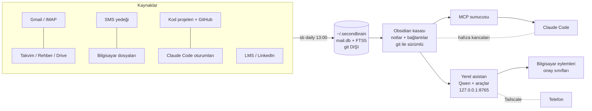

# Second Brain Kit

Kendi bilgisayarında çalışan, seni tanıyan bir **ikinci beyin + kişisel asistan**. Mailin, takvimin, Drive'ın, rehberin,
SMS'lerin, LinkedIn'in, okul sistemin, kod projelerin ve Claude Code oturumların tek bir **Obsidian kasasına** toplanır,
birbirine bağlanır ve her gün kendiliğinden güncellenir. Üstüne iki asistan oturur:

- **Claude Code** — her oturumun başında seni, kurallarını, açık işlerini ve kaldığın yeri hatırlar (MCP + hafıza kancaları).
- **Yerel asistan (Qwen, Ollama)** — ücretsiz, bilgisayarında çalışır. Obsidian'ın içinde ve telefonundan konuşursun:
  "son mail neydi", "cuma 15:00 doktor ekle", "Spotify'da X çal", "ekranımda ne var", "şu başvuru kabul edildi, notu güncelle".

> Windows'ta günlük kullanımda sınanmıştır. macOS desteği yazılmıştır ama gerçek Mac'te doğrulanmamıştır — bkz. [docs/MAC.md](docs/MAC.md).

---

## Ne yapar?

| Alan | Ne olur |
|---|---|
| **Toplama (her gün)** | Gmail (salt-okunur), şirket/okul IMAP, Google Takvim, Rehber, Drive (paylaşılanlar dahil), SMS/arama yedeği, bilgisayardaki dosyalar ve belge içerikleri, kod projeleri + GitHub, Claude Code oturumları, okul LMS (Moodle) bildirimleri, LinkedIn arşivi |
| **Kasa (Obsidian)** | Dersler, projeler, başvurular, kişiler, konular, teknolojiler — hepsi `[[bağlantılı]]`, renkli grafik. Proje ve ders "dosyaları" Claude ile derlenir (mimari, durum, açık işler, kararlar) |
| **Takvim** | Mailden/SMS'ten tarih çıkarılır (yerel model) → emin olunamayanlar onay listesine; etiket kuralları (`[SINAV]` kırmızı, `[ÖDEV]` 23:59 vb.) otomatik renk + hatırlatma |
| **Sabah özeti** | Her gün mail: takvim, 7 günlük teslimler, önemli mailler, SMS, asistanın dün yaptıkları, hatalı adımlar |
| **Yerel asistan** | Kasa soruları, takvime **onaylı** ekleme/silme, not güncelleme/arşivleme (git ile geri alınır), hatırlama ve kural öğrenme, hızlı not kutusu, uygulama açma, medya, YouTube/Spotify (Premium'da doğrudan çalma), sistem bilgisi, terminal (güvenli sınıflar), ekran/kamera okuma (OCR + görsel model), WhatsApp mesajı (onaylı), 15 dk kala bildirim |
| **Telefon** | Tailscale özel ağı + 6 haneli eşleme: asistan telefonda da çalışır; telefondan gelen her bilgisayar eylemi onaya düşer |
| **Claude Code hafızası** | Oturum başında kurallar + hafıza + açık konular + son oturum kartları + o klasörün projesi enjekte edilir; her oturum devir kartı bırakır |

## Mimari (kısa)



Ayrıntı: [docs/MIMARI.md](docs/MIMARI.md) · Tasarım kararları ve dersler: [docs/NEDEN.md](docs/NEDEN.md) · Güvenlik: [docs/GUVENLIK.md](docs/GUVENLIK.md)

## Gereksinimler

| | Zorunlu mu | Not |
|---|---|---|
| Windows 10/11 ya da macOS 13+ | ✔ | |
| [Obsidian](https://obsidian.md) | ✔ | kasayı görmek için |
| Google hesabı + Google Cloud OAuth istemcisi | ✔ | 5 dk, ücretsiz — [docs/KURULUM-GOOGLE.md](docs/KURULUM-GOOGLE.md) |
| [uv](https://docs.astral.sh/uv/) + Python 3.12 | ✔ | kurucu kendisi kurar |
| [Ollama](https://ollama.com) + 16 GB ekran kartı | önerilir | yerel asistan; daha zayıf makinede `qwen3:4b` |
| [Claude Code](https://claude.com/code) (Pro/Max abonelik) | önerilir | derin derleme + MCP + hafıza |
| git | önerilir | kasada geri alma ve yedek |
| Tailscale, Spotify Premium, şirket IMAP | isteğe bağlı | |

## Kurulum (tek komut)

```powershell
# Windows (PowerShell) — repo klasöründe
powershell -ExecutionPolicy Bypass -File install.ps1
```

```bash
# macOS — repo klasöründe
bash install.sh
```

Kurucu sırayla sorar ve yapar: profil → kasa (şablondan) → ayarlar → Python ortamı → Google girişi → Claude Code (MCP + kancalar) →
Ollama modelleri → zamanlayıcı → git → `sb doctor` kontrolü. **Tekrar çalıştırılabilir**; var olan notlarına ve ayarlarına dokunmaz.
Kod güncellemesi için repoyu `git pull` edip kurucuyu yeniden çalıştırman yeter.

## Kurulumdan sonra (sırayla)

1. **Obsidian** → *Open folder as vault* → kasa klasörü. *Community plugins* → **Obsidian Git** (10 dk'da bir otomatik commit önerilir).
2. Kontrol: `uv run --directory <kasa>/_system python -m sb doctor` → ✗ olan her satır ne yapılacağını söyler.
3. İlk toplama (uzun sürebilir): `... -m sb daily --force` (sonra her gün 13:00'te ve oturum açılınca kendiliğinden).
4. Asistan: Obsidian'da `Asistan.md` notunu aç (sağ kenar çubuğuna sürüklemen önerilir).
5. İsteğe bağlı: [Telefon](docs/KURULUM-TELEFON.md) · [Spotify](docs/KURULUM-SPOTIFY.md) · [SMS yedeği](docs/KURULUM-SMS.md) ·
   [LinkedIn arşivi](docs/KURULUM-LINKEDIN.md) · [Telegram](docs/KURULUM-TELEGRAM.md) · [Syncthing (kasa telefonda)](docs/KURULUM-SYNCTHING.md)

## Günlük kullanım

| İstek | Nerede |
|---|---|
| "Bu hafta neler var?", "son mail neydi", "X projesinde ne karar verdik" | Asistan (Obsidian/telefon) ya da Claude Code |
| "Cuma 15:00 doktor ekle", "takvimdeki X'i sil" | Asistan → onay kartı |
| "Başvurum kabul edildi", "ödevi bitirdim", "şu notu arşivle", "geri al" | Asistan (sormadan yapar, sabah raporunda yazar) |
| "Not al: …" | Asistan → `00-Inbox/Dump` → her gün yerine dağıtılır |
| "Bundan sonra hep şöyle yap" / "Bunu hatırla" | Asistan → `Asistan kuralları.md` / `Asistan hafızası.md` (Claude Code da okur) |
| Kod/proje işi | Claude Code: oturum başında hafıza kendiliğinden gelir |
| Video, makale, aklına gelen bir şey | Kopyala → **Ctrl+Alt+B** (Beyne at): video/sayfa özetlenir, metin not kutusuna düşer |
| "Neler bağlı, ne eksik?" | Kasada `Araçlar ve erişimler` notu (her gün yenilenir) ya da `sb doctor` |

Komut satırı: `sb --help` (40+ komut: `daily`, `doctor`, `search`, `add-event`, `chat`, `linkedin-import`, `housekeep`, …).

## Klasörler

```
<kasa>/
  00-Inbox/        onay-bekleyenler, Dump (hızlı notlar), _imports (zip'ler, git dışı)
  10-Dersler/      ders notları + teslimler (takvim/ÖBS/LMS'den)
  20-Projeler/     kod projeleri (derlenmiş proje dosyaları)
  30-Kariyer/      başvurular, görüşmeler, LinkedIn profili
  40-Kaynaklar/    Konular, Teknolojiler, Mail, Drive, Bilgisayar indeksleri
  50-Günlük/       günlük + sabah özeti
  60-Kişiler/      rehber + LinkedIn kişileri
  90-Arşiv/        biten/eskiyen (silme yok, buraya taşınır)
  _system/         kod (sb/), araçlar (tools/), ayarlar (config/), testler
  Asistan.md · Asistan kuralları.md · Asistan hafızası.md · Son oturum.md · Açık konular.md · Dashboard.md
~/.secondbrain/    yerel arşiv (mail.db), anahtar dosyası, kayıtlar — git'e ve telefona GİRMEZ
```

## Güvenlik özeti

- Mail **salt-okunur** (Gmail `readonly`, IMAP `EXAMINE`). Kod mail gönderemez/silemez (sabah özeti hariç: yalnız kendi adres listene).
- Şifre/token **işletim sisteminin şifre kasasında** (Windows Kimlik Yöneticisi / macOS Anahtar Zinciri). Repoda ve kasada gizli bilgi yok.
- Asistan eylemleri üç sınıf: **serbest** (geri alınabilir), **onaylı** (kart), **yasak** (onayla bile çalışmaz). Ekran/kamera içeriği
  okunduğu turda her eylem onaya düşer (istem enjeksiyonuna karşı). Telefon yalnız Tailscale özel ağında.
- Kasadaki her asistan değişikliği ayrı git commit'i → "geri al".

## Güncelleme

```bash
sb update            # ya da: uv run --directory <kasa>/_system python -m sb update
```
Kit klasöründe `git pull` yapar, yalnız kodu yeniler; notlarına, `config/*.yaml` ayarlarına ve şifrelerine dokunmaz.
Ne değiştiğini `CHANGELOG.md` yazar. Yalnız bakmak için `sb update --check`, kurulu sürüm için `sb version`.

## Testler

```bash
cd <kasa>/_system && uv run pytest -q          # 90+ birim testi (gerçek hesap/ağ gerektirmez)
```

Her push'ta GitHub Actions Windows ve macOS'ta sıfırdan kurulum yapıp testleri çalıştırır (`.github/workflows/test.yml`).
