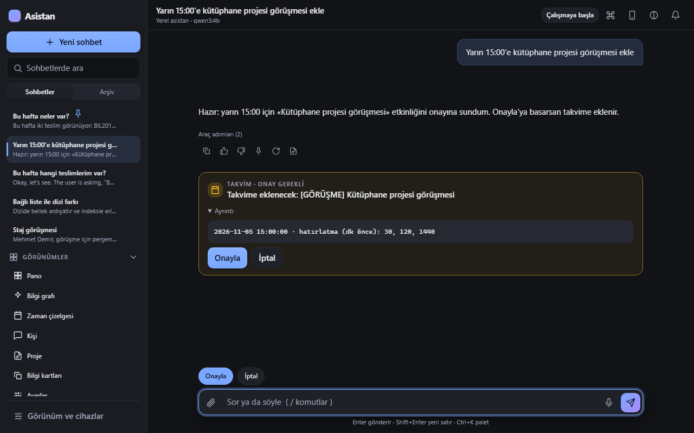

# 09 · Asistanı kullanmak: sohbet, / komutları, onay kartları, ses, telefon

Asistan, kasanı ve arşivini bilen yerel bir sohbet yardımcısıdır. Obsidian yan panelinde, uygulama penceresinde ve telefonda aynı asistan çalışır. Bu bölüm nasıl konuşacağını, hangi komutların olduğunu ve onay kartlarının nasıl işlediğini anlatır.

## İlk soru

Uygulamayı aç (ya da [kurulum turundaki](02-sihirbaz-adim-adim.md) 5 adımı izle):

1. Alttaki mesaj kutusuna yaz: `bugün neyim var?`
2. **Enter**. Asistan takvimine ve notlarına bakıp cevaplar. Cevabın altında kaynak notlar listelenebilir; tıklayarak açarsın.
3. Devam etmek için aynı sohbette yazmaya devam et; asistan bağlamı hatırlar.

## Doğal dille ne isteyebilirsin?

Asistan yalnız **açık olan modüllerin** işlerini yapar. Örnekler (kendi verinle çalışır):

| Alan | Örnek istek | İlgili modül |
|---|---|---|
| Soru-cevap | `son gelen mail neydi?` · `geçen ay kimden fatura geldi?` · `proje X'te en son ne yaptık?` | [Arama ve cevaplar](moduller/search.md), [Gmail](moduller/gmail.md), [Beyin dizini](moduller/brain.md) |
| Takvim | `cuma 15:00 doktor ekle` · `yarın neyim var?` · `perşembe toplantısını sil` | [Google Takvim](moduller/calendar.md) (onay kartıyla) |
| Notlar | `şu başvuru kabul edildi, notu güncelle` · `bu notu arşivle` | [Yerel asistan](moduller/assistant.md) |
| Hızlı not/görev | `not: yarın dilekçeyi yazdır` · `görev ekle: rapor taslağı` | [Not kutusu](moduller/inbox.md), [Görev ve planlama](moduller/tasks_plan.md) |
| Bilgisayar | `hesap makinesini aç` · `sistem bilgisi` · `sesi kıs` | [Bilgisayar kontrolü](moduller/computer.md) |
| Müzik/video | `Spotify'da X çal` · `YouTube'da Y aç` | [Spotify ve YouTube](moduller/media.md) |
| Ekran/kamera | `ekranımda ne var?` | [Ekran ve kamera](moduller/vision.md) |
| WhatsApp | `Ayşe'ye "geç kalacağım" yaz` | [WhatsApp](moduller/whatsapp.md) (onay kartı; **Onayla**'ya basınca **gönderilir**) |
| Plan | `bugünü planla` · `haftamı planla` | [Görev ve planlama](moduller/tasks_plan.md) |
| Web | `... için web'de ara` | [Bilgisayar kontrolü](moduller/computer.md) |

Hangi isteğin hangi modüle bağlı olduğu bilinmiyorsa [Özellik kataloğu](17-ozellik-katalogu.md)na bak. Bir modül kapalıysa asistan o aracı kullanamaz ve söyler.

### İyi soru sormanın ipuçları

- **Zaman süzgeçleri** anlar: `geçen ay`, `ekimde`, `hocadan gelen mailler`.
- Kaynak göster demene gerek yok: cevaplar **kaynak numaralıdır** ([1], [2]); numaraya tıkla.
- Belirsizse asistan tahmin etmek yerine sorar ya da onaya sunar (özellikle tarih ve silme işlerinde).
- Uzun işler (ör. büyük belge özeti) yerel modelle birkaç dakika sürebilir.
- Yanlış bir şey yaptıysa son kasa değişikliğini `sb asistan-undo` ile geri alabilirsin; kasa ayrıca git ile sürümlüdür.

## / komutları

Mesaj kutusuna **/** yazınca komut listesi açılır: ok tuşlarıyla gez, **Enter** ya da **Tab** ile seç. Esc kapatır.

| Komut | Yazım | Ne yapar |
|---|---|---|
| `/yeni` | `/yeni` | Yeni sohbet başlatır |
| `/ara` | `/ara fatura nisan` | Kasada ve arşivde arar; ilk 8 sonucu tür ve özetle listeler |
| `/not` | `/not yarın dilekçe` | Gelen kutusuna (`00-Inbox`) hızlı not düşer |
| `/gorev` | `/gorev rapor taslağı` | Yeni görev ekler (en çok 120 karakter) |
| `/ozet` | `/ozet` | Bu sohbeti 5 maddede özetler (konu, kararlar, açık işler) |
| `/hatirla` | `/hatirla kahveyi sütsüz içerim` | Kalıcı bilgi hatırlar (hafızaya yazar) |
| `/unut` | `/unut kahve tercihi` | Bir konuyu unutma isteği: eşleşmeleri bulur, **onay kartı** çıkarır; onaylarsan siler (arşive taşır) |
| `/bugun` | `/bugun` | Yaklaşan teslim/sınav/başvuru tarihleri ve onay bekleyen takvim adayları |
| `/kisi` | `/kisi Ayşe Yılmaz` | **Kişi** görünümünü açar |
| `/proje` | `/proje second-brain` | **Proje** görünümünü açar |
| `/kart` | `/kart` | **Bilgi kartları** tekrar oturumunu açar |

Metin gereken komutlar (`/ara`, `/not`, `/gorev`, `/hatirla`, `/unut`, `/kisi`, `/proje`) metinsiz yazılırsa «/komut için metin gerekli» der. Bilinmeyen komutta «bilinmeyen komut: /…». Bu komutlara metin olarak yazdığın şey **gizli veri maskelemesinden geçer** (kart numarası vb. kaydedilmez).

## Onay kartları

Bazı işler **kendiliğinden yapılmaz**; asistan önce bir kart çıkarır:

- **Takvime ekle/sil** — Takvim · onay gerekli
- **Komut çalıştır** — Komut · onay gerekli (sınıflama aşağıda)
- **Bir konuyu unut / sil** — Unutma / Silme
- **WhatsApp mesajı** — kart mesajın tam metnini ve alıcıyı gösterir; **Onayla**'ya basınca mesaj **gönderilir** (taslak olarak kalmaz). WhatsApp penceresi öne gelmezse güvenlik için Enter'a basılmaz, mesaj WhatsApp'ta hazır bekler
- **SMS**, **Mail taslağı** — taslak hazırlanır, **gönderilmez**
- **Not güncelleme/arşivleme, kural ekleme, hafızaya yazma** — izin profiline göre (aşağıda)

Kartın yapısı: üstte tür etiketi («Takvim · onay gerekli»), altında ne yapılacağı, altta **Onayla** ve **İptal**. Onaylayınca satır «Onaylandı — mesaj», iptalde «İptal edildi» olur. Birden çok bekleyen varsa çip «Onayla (N bekliyor)» yazar.

### Onaylar görünümü: hepsi tek yerde

Onay bekleyen her şey **tek bir listede** toplanır: sohbet kartları (komut, takvim, WhatsApp, gece koşusu…), **otomasyonların** dış etkili eylemleri ve mail/SMS'ten çıkarılan ama emin olunamayan **tarih adayları**. Üst çubuktaki **✓ Onaylar** düğmesi (yanındaki sayı bekleyen onay sayısıdır) ya da **Görünümler → Onaylar** bu listeyi açar; her kartta türü, nereden geldiği (sohbet / otomasyon / mail-SMS tarihi), kaynağı (bilgisayar / telefon) ve **Onayla** / **İptal** vardır.

- Onaylar **kalıcıdır**: asistan kapanıp açılsa da kart kaybolmaz; komut, WhatsApp, takvim, gece koşusu ve otomasyon kartları yeniden açılıştan sonra da onaylanabilir. Bellekte hazırlanan birkaç kart türü (ör. unutma, zaman bloğu) yeniden açılışta «süresi doldu» olur; isteği yeniden yaparsın.
- Kartların **süresi** vardır: komut ve WhatsApp 12 saat, diğer sohbet eylemleri 1 gün, takvim önerileri 7 gün, tarih adayları 60 gün. Süresi dolan kart onaylanamaz.
- **Tarih adayları** Obsidian'da `00-Inbox/onay-bekleyenler.md` dosyasında da görünür. Bu dosya listeden üretilir: orada kutuyu `[x]` yapmak onay, satırı silmek iptal demektir; günlük çalışma onaylananları takvime ekler. Onaylar görünümünden onaylarsan hemen takvime eklenir ve satır «→ takvimde» olur.
- **Yeni sohbet** açınca o sohbetin bekleyen kartları iptal olur (eskisi gibi).

**Kurallar:**

1. Takvim ve WhatsApp **her izin profilinde** onaylıdır.
2. Riskli/yazan komutlar (paket kurma, sistem yükseltme, dal silme, ortam değişkeni okuma, dosyaya yazdırma, ağ paylaşımı, kasa dışı dosya okuma…) her zaman onaylıdır.
3. **Komut**, **WhatsApp**, **gece koşusu**, **silme** ve **otomasyon/tarih** kartları yalnız **bilgisayardan** onaylanır, telefondan değil. Telefon yalnız **kendi** açtığı takvim/eylem kartlarını onaylayabilir; bilgisayarda bekleyen kartları (komut metni, WhatsApp mesajı) telefonda görmez.
4. Bir mail/SMS/belge içinde yazan «şunu yap» yönergeleri komut sayılmaz; «kural ekle», «hafızaya yaz», «URL çek» gibi işler yalnız **senin yazdığın** mesajda o istek varsa onaysız ilerler ([Güvenlik ve gizlilik](10-guvenlik-gizlilik.md)).
5. Kalıcı silme yoktur; silinen her şey arşive taşınır.

## Sesli kullanım

1. **Mikrofon düğmesi** (mesaj kutusunun yanında, **Sesle konuş**): bas, konuş, tekrar bas. Konuşman yerel **Whisper** ile yazıya çevrilir ve mesaj kutusuna düşer. Ses modülü açık ve **Sesi kur** yapılmış olmalı ([Modeller ve ses](05-modeller-ses.md)).
2. **Sesli cevap:** **Ayarlar** görünümünde **Cevapları sesli oku** kutusunu aç; **Ses** listesinden ses seç; **Dene** ile dinle.
3. **Uyandırma sözcüğü:** **Ayarlar → Uyandırma sözcüğü** kutusu. Ses modülüne bağlıdır ve **yalnız sekme açıkken** dinler. Varsayılan kapalıdır.
4. **Sesli not ve toplantı/ders kaydı:** kayıt dökümü `40-Kaynaklar/Toplantılar` altına not olur; ses dosyası `.secondbrain/audio`'da kalır.
5. Mikrofon izni sorarsa **İzin ver** (tarayıcı/uygulama ayarlarından değiştirilebilir).

## Telefondan kullanım

[Uygulama turu → Telefon](08-uygulama-turu.md#telefon) bölümündeki eşlemeyi yaptıktan sonra aynı arayüz telefonda açılır. Farklar: izin profilini değiştiremezsin, komut ve WhatsApp kartlarını onaylayamazsın, bağlantı yoksa mesajlar kuyruğa girer, Android'de **Paylaş → İkinci Beyin** ile metin/bağlantı gönderebilirsin.

## Claude Code ile birlikte kullanım

- **Hafıza:** Claude Code her oturumun başında kurallarını, hafızanı, açık konularını ve son oturum kartlarını görür ([Claude Code hafızası](moduller/claude_hooks.md)).
- **Oturum sonu:** önemli bir iş bitince Claude `Son oturum.md`e kart yazar; kalıcı öğrenimler `sb concept`, makbuzlar `sb receipt`, görevler `sb task` ile kaydedilir ([Komut referansı](14-komut-referansi.md#sb-receipt)).
- **MCP araçları:** Claude `brain_search`, `brain_project`, `brain_today` gibi araçlarla kasanı okur ([MCP](06-mcp.md#second-brain-mcpsi)).
- **Gece koşusu:** `00-Inbox/Gece işleri.md` maddelerini `sb night` Claude Code'a sırayla yaptırır ([Gece koşusu](moduller/night.md)).
- **Hafıza modu:** `sb mode normal | ekonomik | manuel` hafıza kancalarının ne kadar bağlam eklediğini ayarlar.

## Gemini ile kullanım ve yerele geçiş

Asistanın sohbet modeli istersen bulutta (Gemini) çalışır; **istediğin anda** yerel modele (Ollama) geçip geri dönebilirsin.

**Nasıl açılır:** `config/llm.yaml` içindeki `tasks:` altına `chat: gemini:gemini-2.5-flash` yaz (Google'dan alınan anahtar: `sb set-secret api-gemini`; bkz. [API anahtarları](04-api-anahtarlari.md)). Hangi Gemini modelinin hesabında açık olduğunu `sb ask "merhaba" --model gemini:<model>` ile dene; Google bazı modelleri yeni hesaplara kapatabilir (404 ya da kota hatası verir). Kit kurulumunda bu satır kapalıdır, asistan varsayılan olarak yereldedir.

**Nasıl geçilir:**
- Uygulamanın üst çubuğunda sohbet başlığının altındaki model adına («Gemini 2.5 Flash · bulut» ya da «qwen3:14b · yerel») tıkla; menüden **bulut** ya da **yerel**i seç. Seçim bir sonraki mesajdan itibaren geçerlidir. Klavyeyle: model adına Tab ile git, Enter, ok tuşları, Enter; Esc kapatır.
- Komut satırı: `sb chat-mode local`, `sb chat-mode cloud`, `sb chat-mode status`.
- Seçim `~/.secondbrain/chat_mode.json` dosyasında durur ve yeniden başlatmada korunur. Mod telefondan da değiştirilebilir (eşlenmiş cihaz yeterli; her istek eşleme, Origin ve jeton denetiminden geçer, eşlenmemiş cihaz reddedilir). Telefonda da menüdeki gizlilik satırı görünür: bulut modunda mesajların Google'a gider.

**Hangi veri Google'a gider:** bulut modunda mesajın, sohbet geçmişin ve asistanın o tur için kasadan/arşivden getirdiği parçalar (not, mail, SMS, belge, takvim özetleri) Gemini API'ye gönderilir. Bu bilgisayardan çıkar.

**Hangi veri gitmez:** şifre, API anahtarı, IBAN, geçerli kart numarası, TC kimlik numarası, doğrulama kodu gibi hassas değer ya da şifre/banka gibi sır konusu içeren turlar otomatik **yerel modelle** cevaplanır. `private` işaretli notlar buluta hiç gönderilmez. İzin profili **sıkı** ise bulut kapalıdır. Bu korumalar bulut modunda da aynen sürer.

**Hangi modelin cevapladığı görünür:** her cevabın altında küçük bir etiket vardır (ör. «Gemini 2.5 Flash (bulut)» ya da «qwen3:14b (yerel) · hassas içerik»).

**Bulut yanıt vermezse:** kota, ağ, anahtar ya da sunucu hatasında (ve `fallback_to_local` açıkken) o tur yerel modelle cevaplanır; cevabın başında «Bulut modeli yanıt vermedi, bu tur yerel modelle cevaplandı: …» yazar. Sessizce düşmez.

**Bütçe:** her bulut çağrısı `sb usage` kaydına yazılır. `budget:` ayarındaki günlük/aylık sınır dolunca bulut çağrısı yapılmaz, tur yerele düşer ve nedeni («bütçe doldu») görünür. Model menüsü bugünkü harcamayı gösterir.

**Gizlilik hakkında dürüst not:** Google'ın Gemini API şartları değişebilir. Bilgimize göre ücretsiz katmanda gönderilen veriler Google tarafından ürünleri geliştirmek için kullanılabilir (insanlar tarafından okunabilir), ücretli (faturalandırmalı) katmanda kullanılmaz. Bu bilgiyi kendin kontrol et: Google'ın güncel «Gemini API Additional Terms» sayfasına bak. Kişisel yazışma ve notlar için hassas olanı yerelde bırak ya da yerel modda çalış.

**Yerele nasıl dönersin:** model adına tıkla → **Yerel**, ya da `sb chat-mode local`. Yerel modda bulut hiç çağrılmaz.

## Sınırlar ve beklentiler

- Yerel model, büyük bulut modellerinden küçüktür; karmaşık sorularda hata yapabilir. Önemli kararlarda kaynağı kendin kontrol et.
- Asistan veri yoksa bilmediğini söyler; kaynağı olmayan bilgiyi doğrulamaz.
- Mail/arşiv salt okunur olduğu için «bu maili sil/cevapla» gibi istekler **taslak** üretir ya da yapılamaz.
